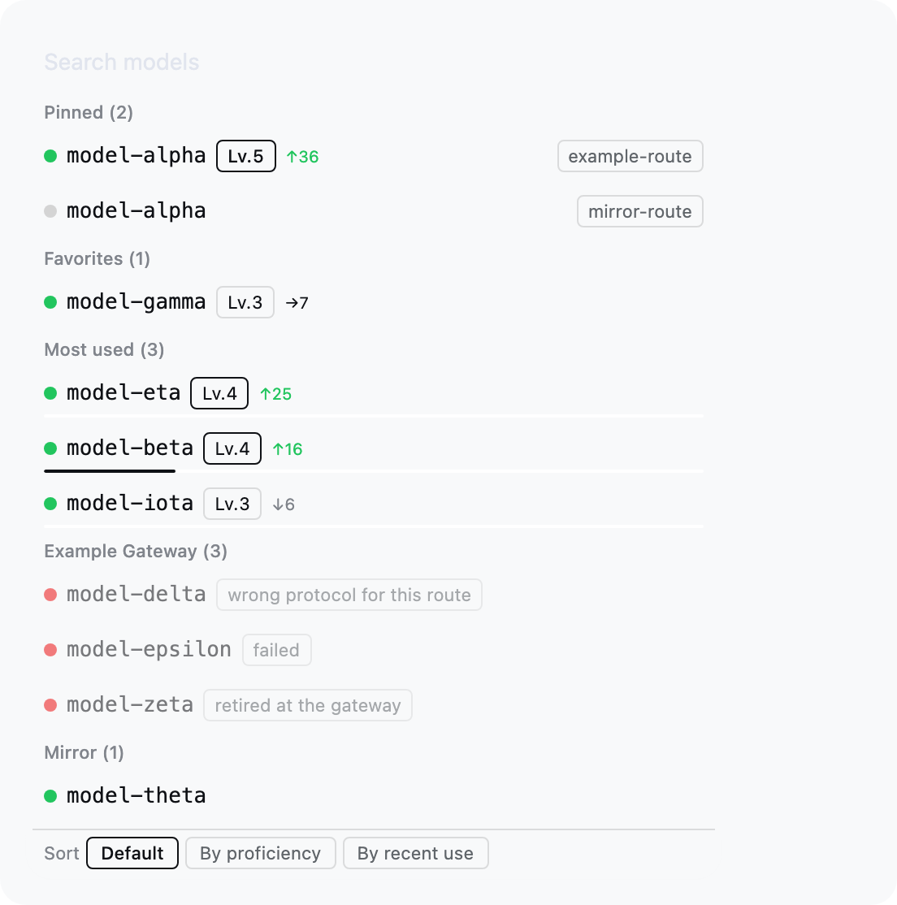
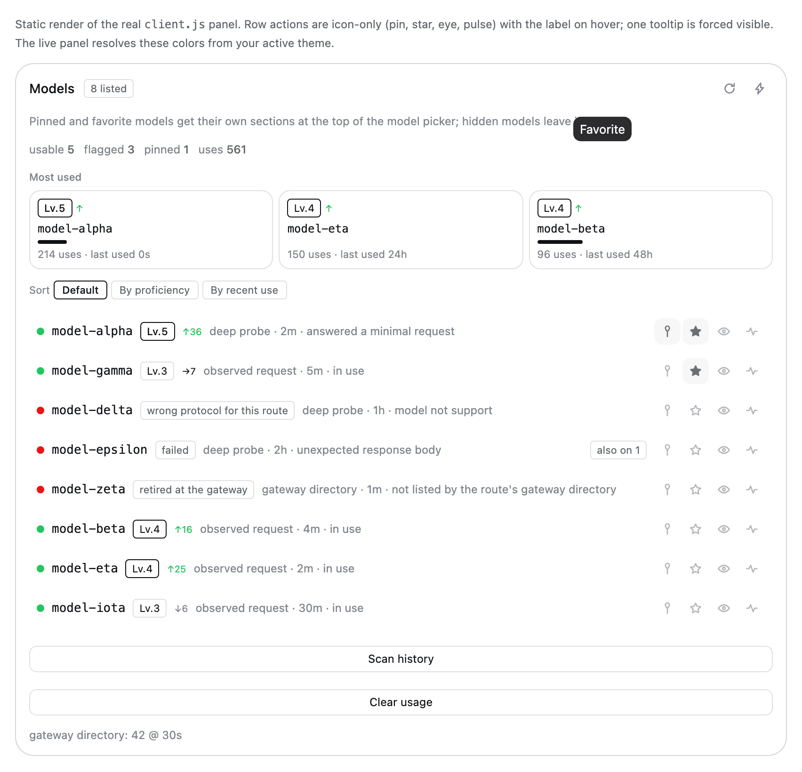

# dsh-llm-manage

A persistent [DeepSeek Harness](https://github.com/deepseek-ai/deepseek-harness) plugin that
manages the model inventory of a configured LLM route: pins and favorites, a per-model
reason why each model is unusable, gateway directory reconciliation, and automatic
fallback when one model's quota runs out.

**No screenshots are committed, on purpose.** `screenshot.mjs` captures a *running* harness,
so the images show whatever routes and model inventory that harness has — the maintainer's own
deployment. A route name rendered into a PNG cannot be found by a text scan, which is how a
set of them was published once. Run the script against your own harness (see
[Looking at the panel without restarting](#looking-at-the-panel-without-restarting)) and you
get your own routes, which is the only version of that picture that means anything to you.

## Why

A route that aggregates many providers behind one gateway exposes its whole catalogue as
one flat list. Five things then go wrong at once, and none of them is the gateway's fault:

| Pain | What this plugin does |
|---|---|
| A long list, favorites buried | Pin and favorite models; the picker lifts them into their own sections at the top, and the panel sorts pinned → favorite → recent → rest |
| Retired models still listed; selecting one errors | Reconciles the route's `models:` list against the gateway's own `GET {baseURL}/models` directory and flags anything missing as retired |
| Quota exhausted, manual switching | Watches `agent/request-error`, switches to the next usable model on a model-scoped quota failure, and shows a banner naming the model it moved for |
| The same model served by several providers | Marks each row with how many other routes also serve it, instead of hiding the copies |
| Models that cannot be called at all | Probes with a minimal request and labels the incompatibility honestly |

Nothing here is hard-coded to one gateway or one model id.

## Install

```
dsh plugin --profile web add /absolute/path/to/dsh-llm-manage
```

`dsh plugin` forwards the arguments after `--profile <name>` to pnpm inside that profile's
directory, so anything pnpm accepts works here (`add`, `remove`, `why`, …). Installing from a
path links the directory, which is what makes local edits show up without reinstalling; use
the git URL instead to get a copy:

```
dsh plugin --profile web add git+https://github.com/PhilYue/dsh-llm-manage.git
```

The package installs as a bundle: its `dsh.bundle.patch` row inserts one Host plugin, and
its `dsh.client` declaration makes the web shell load the browser half. The Host half
needs a **full harness restart**; the browser half is picked up by the client HMR watcher,
so a page refresh is enough. See "Applying a change" below.

## Configuration

Every value lives in the plugin row's `config`, so your own patch layer keeps overrides
across upgrades. Defaults:

```yaml
- id: llm-manage
  name: 'dsh-llm-manage'
  config:
    selector:
      mode: managed     # 'native' withdraws the shadowed picker
    probe:
      intervalMs: 1200  # delay between deep probes
      timeoutMs: 30000
      batch: 40         # probes accepted per request
    directory:
      ttlMs: 1800000    # how long a gateway directory read is trusted
    fallback:
      enabled: true
      chain: []         # 'route/model' entries, tried first
```

The fallback chain order is: `fallback.chain`, then pinned models, then favorites, then the
remaining models on the same route, then other routes. Models already known to be retired,
protocol-incompatible, hidden, or inside their quota cooldown are skipped. At most three
automatic switches happen per turn.

### Which failures switch, and which never do

The rule is **scope**, not severity:

| Failure | Scope | Switches? |
|---|---|---|
| model not found / retired | one model | yes |
| wrong protocol for this route | one model | yes |
| per-model quota exhausted | one model | yes |
| other per-model failures | one model | yes |
| account-wide rate limit | the whole API key | **never** |
| account-wide quota | the whole API key | **never** |

A model-scoped failure moves to another model, because a different model can serve the
turn. An account-scoped failure never moves: every model shares that key, so switching
would only hide the real problem and burn another request.

### A probe is not a routing event

"Unusable" and "move the conversation" are two different conclusions, and only a **failed
request** reaches the second one:

- A **failed request** (`agent/request-error`) is the live conversation hitting a wall. If
  the failure is model-scoped, the turn is retried on the next usable model and a banner
  names the model it moved for.
- A **failed probe** is an answer to a question you asked about a model. It records that
  model's health — so the *next* real switch skips it — but it does **not** touch whichever
  session happens to be using it. Moving a live conversation because of a diagnostic you
  ran would be switching models behind your back, which is the thing this design forbids.

Concretely, with `model-gamma` selected and its quota exhausted:

| Event | Selected model afterwards |
|---|---|
| you deep-probe `model-gamma`, and the probe fails | still `model-gamma` |
| a real request on `model-gamma` fails with per-model quota | `model-beta` (next usable), banner shown |
| a real request fails with an account-wide key limit (2008) | still `model-gamma` |

At most three automatic switches happen per turn, and if the chain finds nothing usable the
failure is passed through untouched rather than retried in a way that cannot succeed.

Some gateways report a *model's* quota exhaustion as HTTP 429, which the harness's own
classifier maps to a retryable `RATE_LIMIT` — indistinguishable from an account-wide rate
limit. The two need opposite handling, so this plugin reads the gateway's numeric business
code out of the error body instead of trusting the mapped code. The code table is at the
top of `index.js`; adjust it there if your gateway numbers things differently.

## Why probing is manual

`GET /v1/models` is free but is only a directory, not a callability list: a model can be
advertised and still fail on first use (wrong protocol, no capacity, image-only). Probing
each model deeply is therefore the only way to learn whether it works — and deep probes
spend the gateway's **per-key** rate budget, so a sweep large enough to be useful is also
large enough to rate-limit the user out of their own gateway.

Health is learned cheapest-first instead:

1. the free directory set,
2. real request failures as they happen (passive, zero extra traffic),
3. explicit probes the user starts, throttled at `probe.intervalMs` and capped at `probe.batch`.

Each row's status is the strongest evidence available, in this order:

| Status | Means | Shown when |
|---|---|---|
| `retired` | the gateway no longer lists the model | the directory read succeeded and the model is absent from it |
| the recorded health | a probe or a real request produced a verdict | any health record exists for that route+model |
| `ok` | the gateway lists it, and no failure is known | the directory read succeeded and there is no health record |
| `unknown` | nothing is known | the route exposes no `baseURL`, so there is no directory to compare against |

`ok` therefore means "listed and not known to be broken", which is weaker than "verified
working" — a model can be advertised and still fail on first use. The panel keeps the
distinction visible by showing the source alongside the status, so a row reads
**usable · deep probe** once it has actually answered and **usable · never checked** while it
has not. Neither is hidden: the second is the honest label for the majority of a large
catalogue, because verifying all of it at once is what would rate-limit you out.

## Verifying it

Four suites, all runnable without any particular deployment:

```
node verify.mjs          # Host half: registry, gateway, classification, fallback
node verify-client.mjs   # Browser half: renders the panel in jsdom and clicks it
node verify-browser.mjs  # Control geometry in a real engine (headless Chrome)
node verify-live.mjs     # The whole thing against a RUNNING harness (opt-in)
```

Each suite picks a mode automatically:

- **`real`** — this machine has a profile whose first provider route resolves, plus that
  route's credential. The settings under test are then the deployed ones, and the gateway
  directory is read live. This is the mode that catches a fixture agreeing with a wrong
  assumption.
- **`synthetic`** — otherwise. A local stub serves a synthetic catalogue, so every code
  path still runs: offline, deterministically, with no credential and no internal endpoint.

```
LLMM_VERIFY_MODE=synthetic node verify.mjs    # force a mode
DSH_CHECKOUT=/path/to/deepseek-harness node verify.mjs
```

`DSH_CHECKOUT` points at the harness checkout, which supplies the real Tool registry,
React and jsdom. It is not vendored here; the suites try a few conventional locations and
then tell you what to set.

`verify.mjs` also gates the **publish surface**: where the maintainer's
company-information scanner is present it fails if the runtime files (`index.js`,
`client.js`, `package.json`, `cordis.patch.yml`, `icon.svg`) contain anything identifying
a particular employer or internal service; in this published package the scanner is
absent, and the gate says so rather than reporting a pass it did not perform. The scanner
is not shipped because its own rule patterns have to quote the identifiers they look for.

Some checks exist because the live harness caught bugs a shallower suite passed:

- **The suites execute the registered tool**, not just register it. A definition can
  register cleanly and throw on its first call.
- **The fixture context enforces Cordis's inject guard**, so reading `ctx.llm` from
  `apply`'s own context fails exactly as it does live.
- **Never test one half alone.** The two halves can agree on every type and still disagree
  on a field name: the panel once folded `data.snapshot` while the Host returned the same
  state under `value`, so pin/favorite/hide updated nothing until the user reloaded by
  hand. A Host-only suite passed it, and so did a client suite whose other half was a mock
  returning whatever field the client asked for.
- **`verify-browser.mjs`** exists because jsdom has no layout: every
  `getBoundingClientRect()` returns zeros, so a tooltip's position and a button's width
  cannot be measured in-process. It loads the real panel into headless Chrome and asserts
  the geometry the design depends on, then skips with exit 0 when no Chrome-family binary
  is present (`CHROME_PATH` overrides).
- **`verify-live.mjs`** exists because every other suite builds its own page and hands the
  plugin a context it controls — so none of them can catch a contract they do not enforce.
  The plugin declared `slots`, `modelDirectories` and `sessions` at the top level, then
  called `modelDirectories.directoryFor()`, which internally reaches
  `this.ctx.remote.session`. Cordis checks the **consumer's** inject list, so in the live app
  that read threw `cannot get property "remote.session" without inject`, the picker's slot
  entry crashed, and because `Style` renders inside that same subtree the composer's model
  control lost **every rule in its stylesheet**. All three suites were green: the hand-built
  contexts were plain objects that enforced nothing.

  It opens the URL `dsh web` prints — in a real engine, against the real profile, real
  catalogue and real composer — and skips with exit 0 when no live harness answers:

  ```
  DSH_LIVE_URL='http://127.0.0.1:3080/?token=...' node verify-live.mjs
  DSH_LIVE_URL=http://127.0.0.1:3080/ DSH_LIVE_COOKIE='dsh-auth-...=...' node verify-live.mjs
  ```

### Two more contract mistakes the suites had to learn

Both of these shipped, both were green in every suite, and both were found by looking at
the running app. They are worth stating because each one changed what the suites assert.

**The theme cannot be supplied by the thing being tested.** The card was painted with
`--dsw-alias-bg-overlay`, which the plugin token contract labels *"Overlay and popover
background"* — a reasonable reading of the docs. Measured in the app it is `#e9ecf2`, a mid
grey, darker than the white composer it drops out of; DSH's own popovers paint the
translucent `--dsw-specific-menu` on a child layer with a backdrop blur instead. The suites
could not catch it because they defined that token themselves: `verify-browser.mjs` had
`--dsw-alias-bg-overlay:#fff`, and the deleted `preview.mjs` invented the same white. The
suites now carry the values the app actually resolves, and `verify-browser.mjs` fails if the
stylesheet reads any token its theme block does not define — 27 are read. `verify-live.mjs`
asserts the painted surface against the token's real value.

**A stylesheet in a template literal can truncate without a syntax error.** A backtick or
`${` inside a CSS comment ends the literal early. The pieces often still re-parse as
JavaScript, so `node --check` passes, and the failure that reaches you is a browser refusing
the import — the whole client half silently absent. `verify-client.mjs` extracts the literal
and asserts it is intact, which catches the case that parses but is wrong.

  The lesson generalizes past this bug: **a suite that supplies the context cannot verify
  the context.** An inject declaration is a contract with the runtime, and only the runtime
  can check it.

### Looking at the panel without restarting

```
DSH_LIVE_URL='http://127.0.0.1:3080/?token=…' node screenshot.mjs
```

Captures the panel and the model picker out of the running harness, light and dark, into
`docs/` — which is gitignored, so the images stay on your machine. It is the preview of record
because it supplies nothing: it opens the URL `dsh web` printed and photographs what is there.

The images are not committed because a capture of a real harness is a picture of the routes
and model inventory that harness is configured with. That is the maintainer's deployment, and
it is also the one kind of content a text scan cannot inspect: a route name rendered into a
PNG reads as PNG bytes, matches no rule, and passes. Four such screenshots were published
before anyone noticed. `build-public.mjs` now refuses to stage any binary asset, and
`scan-company-info.mjs` reports files it cannot read as unscannable rather than counting them
as clean — the whitelist that decided which extensions to open was the whole defect.

This replaced a `preview.mjs` that rendered the plugin into a hand-written page with a
hand-written theme. That page defined `--dsw-alias-bg-overlay:#fff` — a value the token never
has in the app, where it is `#e9ecf2` — and defined only the 14 tokens the plugin contract
documents while the stylesheet reads 27. The mock showed a white card; the app painted a grey
one. A preview that supplies its own theme cannot show you the theme, and an approved mock is
worse than no mock: it is the reason the grey card shipped.

The replacement supplies nothing of its own and skips with exit 0 when no harness answers, so
it never reports a picture it did not take. To reach the panel it sends the `settings.open`
chord — `primary+alt+Comma` on web, not the plain `primary+Comma` the desktop runtime uses —
then clicks through the settings nav until the panel appears, matching no label because the
labels are localised. A development aid, not a test.

## Where it appears

- **Settings → Models → the provider card**: the management panel.
- **The composer model picker**: the managed picker (set `selector.mode: native` to
  withdraw it and get the shipped picker back untouched).
- **Above the composer**: a banner when this session's model was switched.

### The composer model picker



The picture is a synthetic render, not a photograph of anyone's harness: `preview.mjs`
renders the real plugin code against an invented catalogue — fake models on fake routes —
so the screenshot cannot contain a route you do not already have in front of you in the
source. To see it against *your* catalogue instead, run `screenshot.mjs` against your own
harness: it drives the real settings UI — sending the `settings.open` chord and finding the
Models section — so what you get is your own catalogue in your own theme.

The panel, from the same renderer:



The picker opens on **Pinned**, then **Favorites**, then one section per route. Pins and
favorites are lifted *out* of their route and shown once, at the top, so a favorite is one
click away no matter how many routes the profile has or how many models sit ahead of it
alphabetically. Below the sections, each route still lists everything else, minus the rows
already lifted — every listed model is offered exactly once, and hidden models are not
offered at all.

A model that is both pinned and favorited appears under **Pinned** only, matching the
fallback chain's own precedence, where a pin outranks a favorite.

Because a lifted row is no longer under its route's heading, a section that spans more than
one route prints the route beside each model. The same model id on two routes is two
different selections, and the row has to say which one it means. A section that stays on
one route prints nothing, since the label would be noise on every row.

Rows keep their health dot and reason chip, so an unusable model is visibly unusable here
too — but it is still *selectable*. The plugin's view of a model can be stale, and hiding a
model from the picker is the one thing this design refuses to do silently. Search filters
across the lifted sections as well as the route groups.

The picker is styled from the panel's own vocabulary rather than as a separate design: the
same row box (padding, radius, hover background **and** hover border), the same dimming for
a de-emphasised row, the same focus ring, the same `.llmm-chip` for the route as the panel
uses for "also on", and section headings in the secondary label color. The brand color stays
reserved for state — the panel's active controls and the picker's current row. Two suites
assert this property by property, so the two surfaces cannot drift apart again.

### Panel controls

Row actions are **icon-only** buttons with the label on hover and on keyboard focus, so
four controls fit beside a model name instead of wrapping the row: pin, favorite, hide,
probe. Each carries an `aria-label`, so it stays readable to a screen reader. The header's
two actions (re-check the gateway, deep-probe all) use the same treatment.

The tooltip is rendered at the panel root rather than inside the row, because the row list
is a scroll container that would clip it; it is positioned against the viewport and clamped
so a button near an edge cannot push the label off-screen.

Clicking an action updates the row in the same frame (the flag is applied locally first)
and the Host's authoritative snapshot then replaces it. A failed request rolls the row
back, so the panel never keeps claiming a state the Host refused. Row actions stay visible
at reduced opacity instead of appearing only on hover, because a touch device has no hover.

Every mutating action returns the new state under a top-level `snapshot`; that is the
contract that makes the optimistic update safe.

## Storage

One atomically-written JSON document per route under
`$DSH_HOME/storages/llm-manage/<route>.json`, holding `favorites`, `pins`, `hidden`,
`recent` and `health` (`status`, `source`, `detail`, `scope`, `at`). Deleting the file
resets that route's overlay.

## Agent tool

The `llm_models` tool exposes the same operations: `snapshot`, `pin`, `unpin`, `favorite`,
`unfavorite`, `hide`, `unhide`, `probe`, `sync`, `diagnostics`. `snapshot` and `diagnostics`
need no extra arguments; `sync` needs `route`; `probe` and the overlay actions need both
`route` and `model`. The browser half reads the same data over `POST /api/llm-manage`.

## Applying a change after install

The profile installs this package as a **symlink**, so file edits land in the running
profile immediately. The two halves then behave differently.

**`index.js` (Host half) needs a full harness restart.** The host HMR watcher skips
`node_modules`, where the install symlink lives, and its watch root is the profile
directory — while the real file resolves outside it. A marker written into `index.js` was
still absent from the running Host's responses minutes later, against a listener process
started the previous evening.

**`client.js` (Client half) reloads on its own.** The client HMR watcher is a stat poll
(default 500 ms) over every row in the composed graph — no `node_modules` exclusion — and
it re-reads the bundle from disk. Touching `client.js` produces a
`rebuilt` frame on `/plugins/events`, and the revision the server then advertises matches
one computed from the new file's `mtime`/`ctime`/`size`.

Enabling or disabling the bundle does not bust the ESM module cache for either half.

## Known limits

- Deep probing assumes the OpenAI-compatible `/chat/completions` shape. A route speaking
  another protocol is reported as probed-with-this-shape, not as protocol-aware.
- Protocol mismatches are **labelled, not fixed**. A model's protocol cannot be set
  per-model: `api` is a route-level setting. The supported workaround is registering the
  same `baseURL` as a second route with `api: anthropic-messages` — which only helps if
  your gateway actually serves that endpoint. If it does not, the model is reported as
  protocol-incompatible rather than silently "fixed".
- Passive learning needs a real failed request to observe a reason.
- The quota fallback needs the failing model's id, which it takes from the last
  `agent/request` it observed for that session.
- The managed picker shadows the shipped picker at `priority: -1` and re-supplies its
  `inject` face. That face is a per-registration business contract, so a future change to
  the shipped picker's face needs this plugin updated in step. `selector.mode: native`
  withdraws the shadow without a restart.

## Licence

MIT — see [LICENSE](LICENSE).
